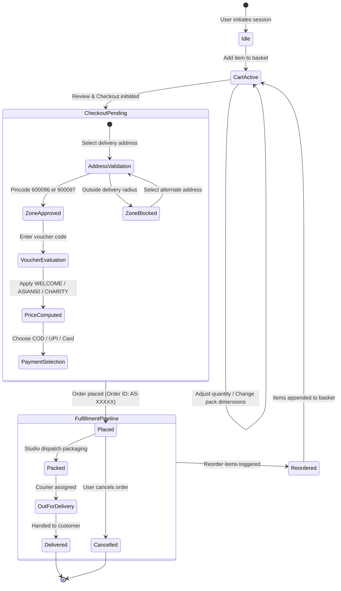
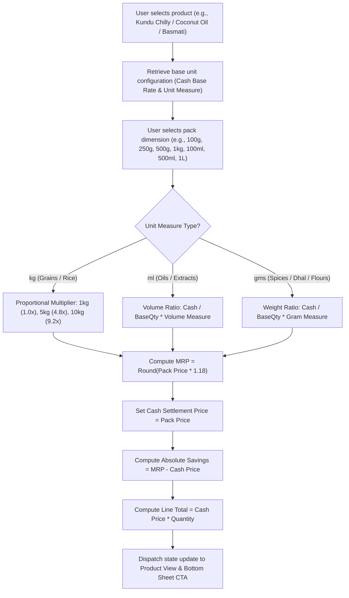
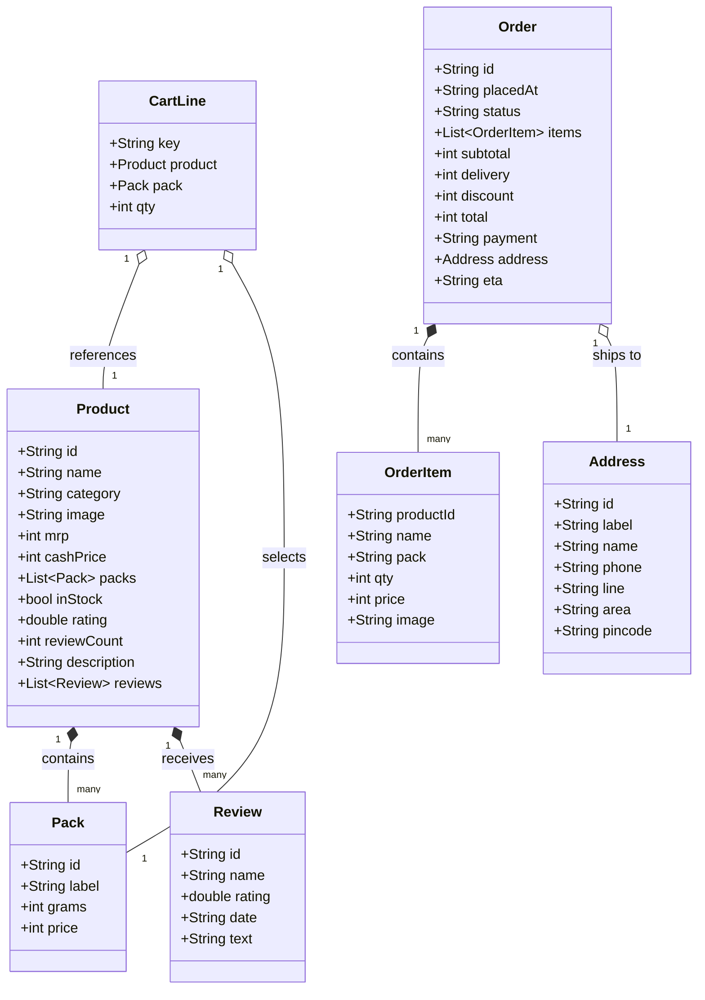

# System Architecture Documentation

This document specifies the technical architecture, data flow, state machine lifecycles, and component interactions powering the Asian Stores mobile client across React Native and Flutter implementations.

---

## High-Level System Architecture

```mermaid
flowchart TD
    subgraph UI_Layer["1. Presentation & Interaction Layer"]
        direction TB
        Splash["Splash View<br/>Physics Basket Animation & Bypass"]
        Auth["Authentication View<br/>1-Tap Demo, Email, Phone OTP, Guest"]
        Home["Home View<br/>Hero Banner, Categories, Collections"]
        Shop["Catalog View<br/>Category Chips, Sort, In-Stock Filter"]
        Product["Product Detail View<br/>Dimension Selector, Cash Pricing, Reviews"]
        Cart["Basket View<br/>Line Items, Stepper, Subtotal Engine"]
        Checkout["Checkout View<br/>Zone Verification, Vouchers, Payments"]
        Orders["Order Tracking View<br/>4-Phase Timeline & Status Advance"]
        Account["Account View<br/>Profile, Policies, FAQs, Studio Info"]
    end

    subgraph State_Layer["2. Business Logic & State Management Layer"]
        direction TB
        subgraph Store_Engines["Shared State Machine (React Context / ChangeNotifier)"]
            AuthEngine["Session & Auth Manager"]
            CatalogEngine["Catalog & Filter Engine"]
            PricingEngine["Dynamic Pricing & Unit Scaler"]
            CartEngine["Cart & Subtotal State Machine"]
            RoutingEngine["Postal Zone Verification (600096, 600097)"]
            VoucherEngine["Voucher Rebate Engine (WELCOME, ASIAN50, CHARITY)"]
            OrderLifecycleEngine["Order Fulfillment State Machine"]
            ReviewEngine["Review & Rating Aggregator"]
        end
    end

    subgraph Domain_Layer["3. Domain & Data Infrastructure"]
        direction TB
        ProductCatalog["Product Catalog (20+ SKUs across 10 Categories)"]
        SeedData["Seed Addresses & Delivery Zones"]
        OrderRecords["In-Memory Ledger (Deterministic Orders)"]
        AssetPipeline["Cloudinary CDN Asset Pipeline (f_auto, q_auto)"]
        CharityPledge["Community Impact Ledger (₹200 per live order)"]
    end

    subgraph Build_Layer["4. Target Platforms & Compilation Pipelines"]
        direction LR
        subgraph ReactNative_Pipeline["React Native / Expo"]
            MetroBundler["Metro Bundler"]
            EASCloud["EAS Cloud Build"]
            GradleLocal["Local Gradle Pipeline"]
            ExpoAPK["Android .APK (Preview / Internal)"]
        end
        subgraph Flutter_Pipeline["Flutter Engine"]
            DartAOT["Dart AOT Compiler"]
            FlutterTool["Flutter Build Engine"]
            FlutterAPK["Android .APK (Release)"]
        end
    end

    %% presentation to state connections
    Splash --> Auth
    Auth --> AuthEngine
    Home --> CatalogEngine
    Shop --> CatalogEngine
    Product --> PricingEngine
    Product --> ReviewEngine
    Cart --> CartEngine
    Checkout --> RoutingEngine
    Checkout --> VoucherEngine
    Checkout --> OrderLifecycleEngine
    Orders --> OrderLifecycleEngine

    %% state to domain connections
    CatalogEngine --> ProductCatalog
    PricingEngine --> ProductCatalog
    CartEngine --> OrderRecords
    RoutingEngine --> SeedData
    OrderLifecycleEngine --> OrderRecords
    OrderLifecycleEngine --> CharityPledge
    ProductCatalog --> AssetPipeline

    %% compilation mappings
    State_Layer -.-> ReactNative_Pipeline
    State_Layer -.-> Flutter_Pipeline
    ReactNative_Pipeline --> ExpoAPK
    Flutter_Pipeline --> FlutterAPK

    classDef presentation fill:#FFFFFF,stroke:#1F7A3A,stroke-width:2px,color:#102018;
    classDef state fill:#E8F5EC,stroke:#145C2A,stroke-width:2px,color:#102018;
    classDef domain fill:#F7FBF8,stroke:#5B6B62,stroke-width:2px,color:#102018;
    classDef target fill:#FFFFFF,stroke:#C45C26,stroke-width:2px,color:#102018;

    class Splash,Auth,Home,Shop,Product,Cart,Checkout,Orders,Account presentation;
    class AuthEngine,CatalogEngine,PricingEngine,CartEngine,RoutingEngine,VoucherEngine,OrderLifecycleEngine,ReviewEngine state;
    class ProductCatalog,SeedData,OrderRecords,AssetPipeline,CharityPledge domain;
    class MetroBundler,EASCloud,GradleLocal,ExpoAPK,DartAOT,FlutterTool,FlutterAPK target;
```

---

## Order Fulfillment Lifecycle & State Machine

The order lifecycle model tracks customer orders from initial placement to doorstep delivery with deterministic transitions:

---

## Dynamic Pricing & Unit Dimension Scaling Engine

Asian Stores provides bulk agricultural grains, cold-pressed oils, and packaged spices with variable packaging units. The diagram below illustrates how cash settlement rates and customer savings are computed in real time:

---

## Dual Framework Component & Data Flow Mapping

Both mobile frameworks consume identical domain models and follow matching unidirectional data flows:

| Architectural Tier | React Native Implementation (Expo) | Flutter Implementation |
| :--- | :--- | :--- |
| **Framework Engine** | React 19.3 / React Native 0.88.0 | Flutter 3.x / Dart 3.x |
| **Language Runtime** | TypeScript 6.0 (Strict mode) | Dart 3.x (Null safety) |
| **Design Language** | Custom Styled Vanilla React Native Components | Material Design 3 (`ThemeData`, `ColorScheme`) |
| **State Storage** | React Context (`StoreContext`) | Provider (`ChangeNotifierProvider`) |
| **State Observer** | Custom Hook (`useStore()`) | `context.watch<StoreProvider>()` |
| **Action Dispatcher** | Context Actions (`addToCart`, `placeOrder`) | Provider Methods (`addToCart`, `placeOrder`) |
| **Navigation Stack** | `@react-navigation/native-stack` 7.x | Flutter Native Navigator 2.0 / `MaterialPageRoute` |
| **Bottom Navigation** | `@react-navigation/bottom-tabs` 7.x | `BottomNavigationBar` with `IndexedStack` |
| **Packaging Target** | EAS Build (`buildType: apk`) / Android Gradle | `flutter build apk --release` |

---

## Data Models Specification

---

  Documented for <b>Asian Stores</b> &bull; i2 Agro Products Private Limited, Chennai, India

